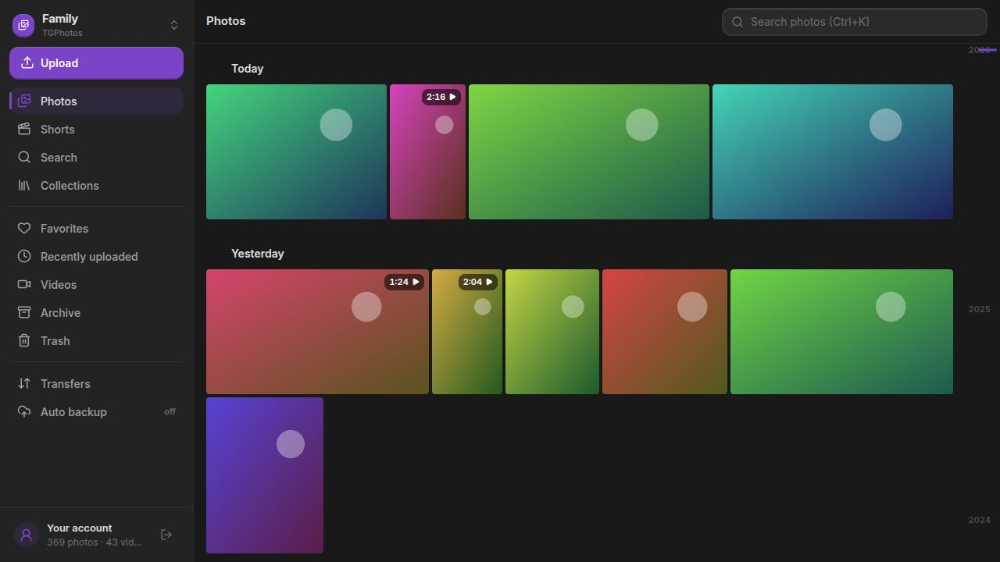

<p align="center"></p>

<h1 align="center">TGPhotos</h1>
<p align="center">A home for your photos and videos, built on Telegram.</p>
<p align="center"><a href="#features">Features</a> · <a href="#installation">Installation</a> · <a href="#getting-started">Getting started</a> · <a href="#questions">Questions</a> · <a href="#contributing">Contributing</a></p>

Keep your library organized across devices, browse it by date, and collect
your favorite moments in albums. TGPhotos combines a photo gallery with
Telegram storage, without asking you to manage individual channel messages.



## Features

- **A library you can explore.** Browse a timeline, open photos and videos, and move through your collection with the date scrubber.
- **Albums and favorites.** Group related media, choose album covers, save favorites, and archive items without deleting them.
- **Less manual uploading.** Add files or folders, or back up selected device folders automatically while the app is running.
- **Details that stay with the photo.** View capture dates, camera information and location when the file contains them.
- **Your library on more screens.** Use desktop controls, a touch interface, or controller mode on a TV or handheld.
- **Shared vaults.** Invite people and manage administrator permissions when your account has the necessary rights.

## Installation

| Platform | Download | Architecture |
| --- | --- | --- |
| Linux | [Flatpak](https://tgcloudapps.github.io/tgcloud-flatpak/tgphotos.flatpakref) | x86_64, ARM64 |
| Windows | [Installer](https://github.com/TGCloudApps/tgphotos/releases/latest) | x64, ARM64 |
| Android | [Mobile APK](https://github.com/TGCloudApps/tgphotos/releases/latest) | ARMv7, ARM64, x86, x86_64 |
| Android TV | [TV APK](https://github.com/TGCloudApps/tgphotos/releases/latest) | ARMv7, ARM64, x86, x86_64 |

### Linux

Install [Flatpak](https://flatpak.org/setup/) 1.16 or newer, then run:

```sh
flatpak install --user https://tgcloudapps.github.io/tgcloud-flatpak/tgphotos.flatpakref
flatpak run com.tgcloud.tgphotos
```

Update the app with `flatpak update --user com.tgcloud.tgphotos`.

### Windows

Download the `.exe` installer for your architecture from the release page and
open it. Choose **x64** for Intel/AMD PCs or **ARM64** for Windows on ARM.

### Android and Android TV

Choose the **android-mobile** APK for a phone or tablet, or **android-tv** for a TV.
Open the downloaded file and allow installation from your browser or file manager
when Android asks. The two variants replace each other on the same device.

## Getting started

1. Sign in with your Telegram account, including your two-step verification password if enabled.
2. Create a vault for your library, or open an existing TGPhotos vault.
3. Choose **Upload** to add photos, videos or a folder.
4. Open **Collections** to create albums, or **Auto backup** to select folders for future uploads.

A vault is a Telegram channel used by the app to store your library. You can keep
separate vaults for different collections and switch between them from the sidebar.

## Questions

### Do I need to create a Telegram channel myself?

No. Create a vault from TGPhotos and the app sets it up for you.

### Can I keep the same photo in several albums?

Yes. Adding a photo to an album does not upload another copy of the original.
Removing it from an album leaves it in your library.

### What is the difference between Archive and Trash?

Archive hides media from the main timeline while keeping it in the vault.
Trash marks it for deletion and keeps it recoverable for 30 days.

### Does automatic backup run when the app is closed?

Keep the app running for automatic backup. On Android, media permissions and
battery settings can also affect when uploads run.

### Where is my data stored?

Content is stored in Telegram channels on your account. The app also keeps local
metadata, thumbnails and temporary transfer files. Ordinary Telegram channels
are not Secret Chats; keep an independent backup of important files.

## Contributing

Bug reports, translations, documentation and focused pull requests are welcome.
Search [issues](https://github.com/TGCloudApps/tgphotos/issues) and existing PRs before
starting. Discuss new features and large changes first.

To submit a change:

1. Fork this repository and create a descriptive branch from the latest `main`.
2. Address one problem with atomic commits in English, using `type: description`.
3. Check the affected behavior and document any checks you could not run.
4. Open a PR against `main` using the template, with a title such as `fix: restore dialog focus`.
5. Explain the problem and result, attach visual evidence for UI changes, and address review feedback in the same PR.

Read [CONTRIBUTING.md](CONTRIBUTING.md) for the Git workflow, commit conventions,
code and translation rules, required PR details, and the review process.

## Documentation

- [Vault format](FORMAT.md)
- [Roadmap](ROADMAP.md)
